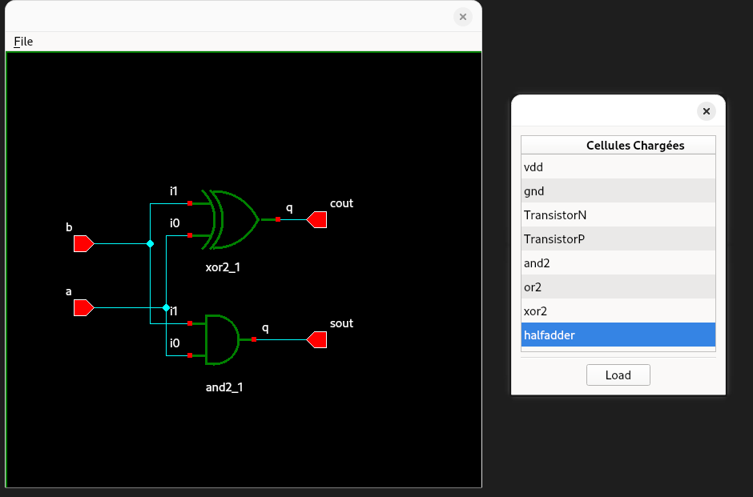

# Hierarchical VLSI Netlist Viewer & EDA Data Model

An Electronic Design Automation (EDA) schematic visualizer and object-oriented netlist modeling framework written in **C++** and **Qt 5**.



## Overview
Modern VLSI CAD flows rely on robust internal graph representations to manipulate integrated circuit netlists. This project implements a full software stack capable of parsing hierarchical netlist descriptions, building an in-memory connectivity graph, and rendering circuit schematics interactively with Qt.

## Key Architectural Highlights

### 1. Object-Oriented Netlist Engine
- **Hierarchical Graph Representation:** Modeled cells, instances, nets, nodes, and bidirectional terminals (`Cell`, `Instance`, `Net`, `Node`, `Term`).
- **Memory Safety & Ownership:** Strict encapsulation using modern C++ design patterns (rule of three/five, virtual destructors), eliminating circular reference leaks in cyclic net topologies.
- **Efficient Traversal:** Encapsulated custom iterators and STL container abstractions to traverse complex connectivity networks without exposing internal storage.

### 2. Serialization & Interchange (XML Engine)
- **Custom XML Driver:** Fully decoupled serialization pipeline capable of parsing and emitting standard circuit syntax.
- **Integrity Validation:** In-flight connectivity checks ensuring resolved instance terminals match master cell interfaces before instantiating the memory graph.

### 3. Interactive Graphical Rendering (Qt / QPainter)
- **Model-View Separation:** Strict isolation between the core topological netlist model and the 2D layout rendering engine (`CellWidget`, `Symbol`, `Shape`).
- **Dynamic Geometric Modeling:** Bounding-box calculations, vector-based logic gate symbols (AND, XOR, transistors), and terminal alignment algorithms.
- **Interactive Inspection:** Interactive cell selector enabling real-time switching between hierarchical logic blocks (e.g., standard cells to full/half adders).

## Tech Stack
- **Language:** C++ (C++11/C++14)
- **GUI Engine:** Qt 5 (`QtWidgets`, `QPainter`)
- **Validation & Profiling:** Valgrind (Memcheck), GDB
- **Build System:** Make / CMake

## Architecture Overview
## Architecture Overview

```text
[XML Netlist File]
        │
        ▼ (Parser / Deserializer)
┌────────────────────────────────────────┐
│             Core Data Model            │
│  Cell ──< Instance ──< Net ──< Node    │
└──────────────────┬─────────────────────┘
                   │ (Signals / Slots & Event Loop)
                   ▼
┌────────────────────────────────────────┐
│             Qt GUI Engine              │
│   CellWidget ── QPainter ── Symbol     │
└────────────────────────────────────────┘
```

## Running the Application
```bash
# Clone the repository
git clone [https://github.com/](https://github.com/)<username>/<repo-name>.git
cd <repo-name>

# Build the project
make

# Run with a target netlist
./netlist_viewer examples/halfadder.xml
```


